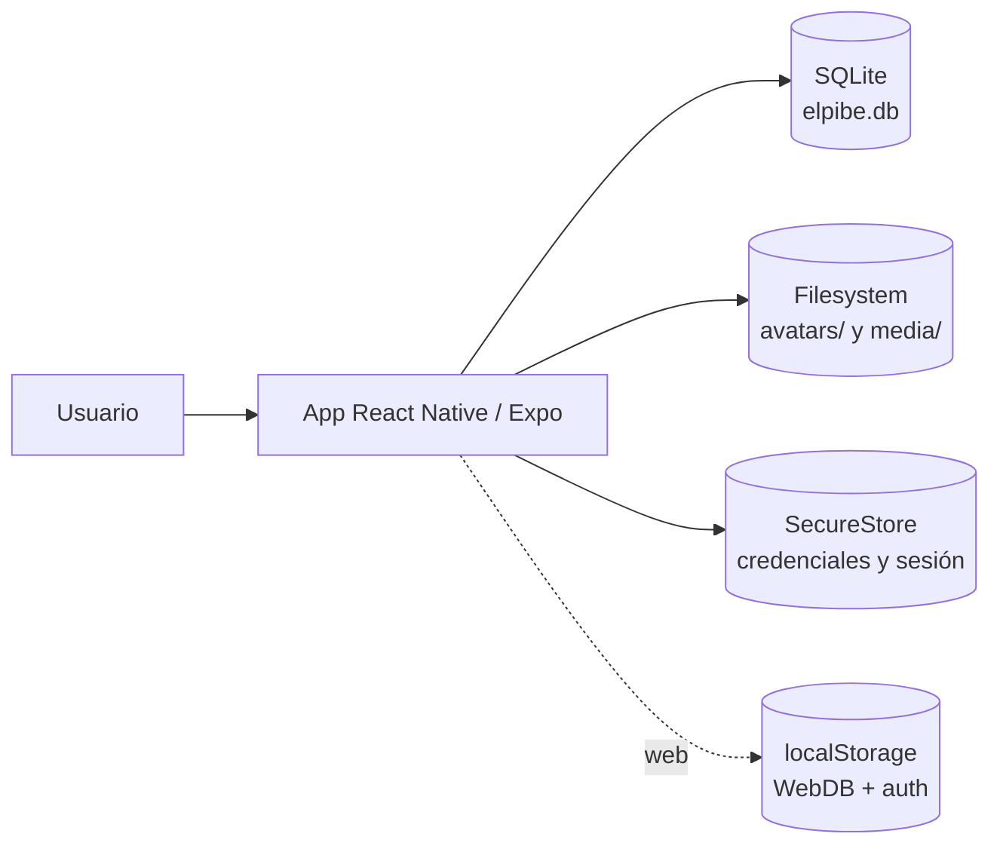
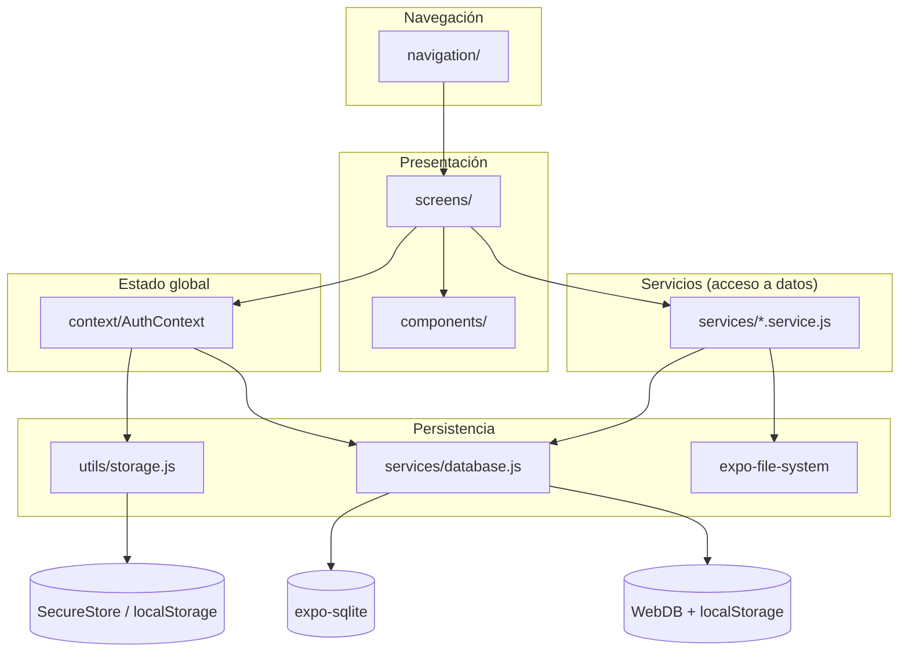
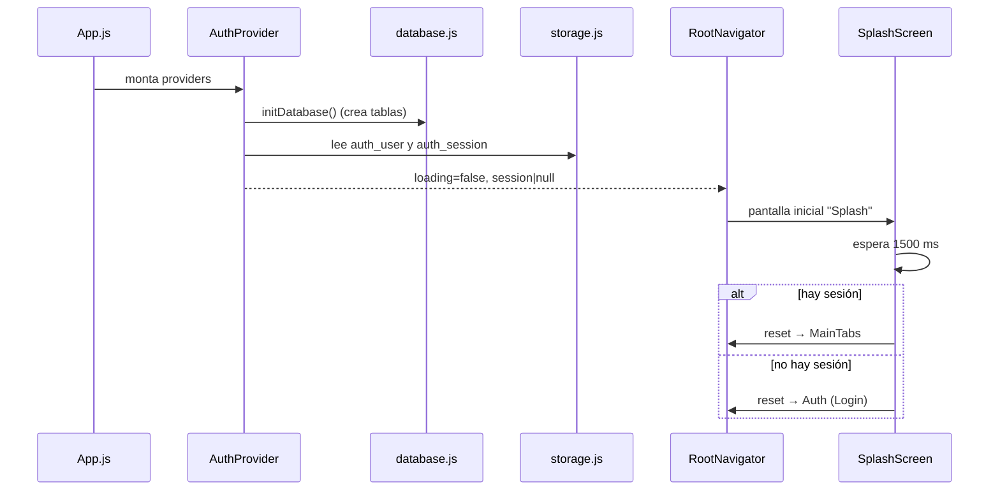
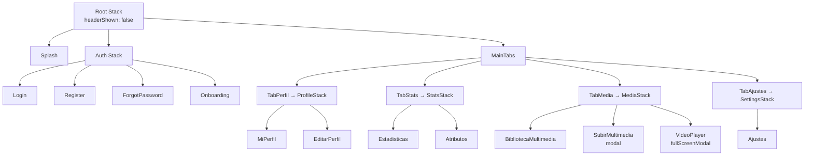
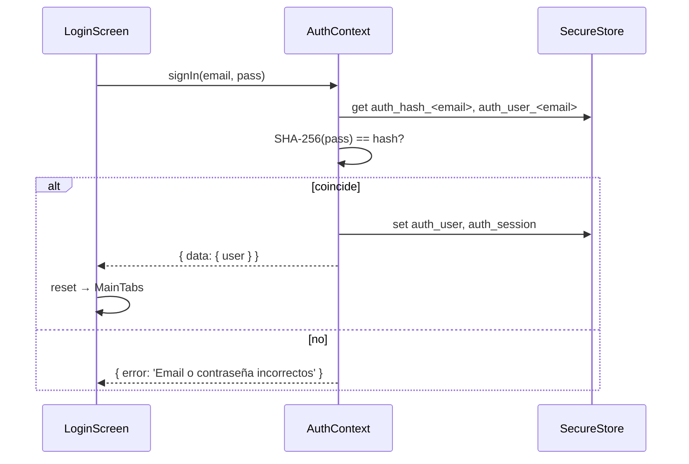
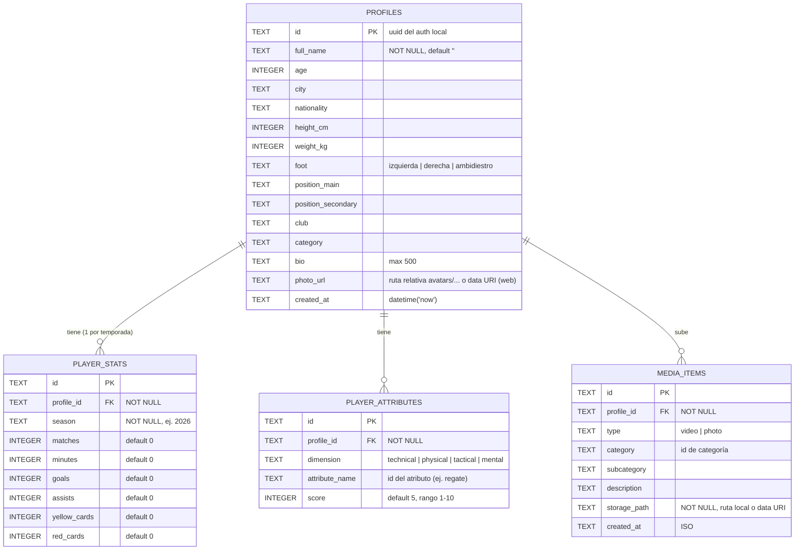
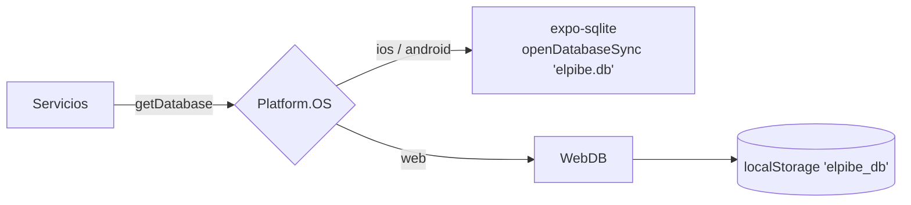
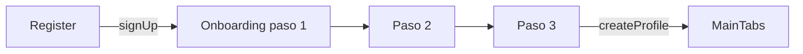
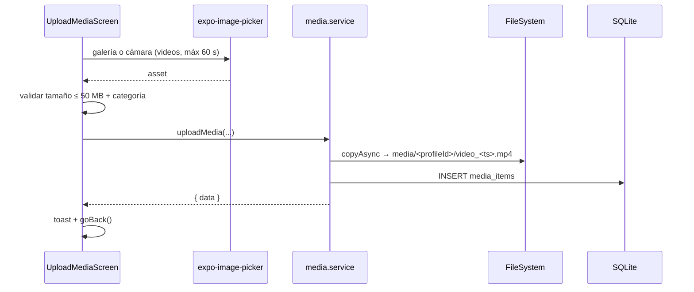

# ElPibe — Arquitectura

> Documento de arquitectura de la app móvil **ElPibe**. Complementa a `AGENTS.md` (reglas para IA) y `DESIGN.md` (sistema de diseño).
> Los diagramas están en [Mermaid](https://mermaid.js.org/) (se renderizan en GitHub y en VS Code).

## Índice

1. [Visión general](#1-visión-general)
2. [Stack tecnológico](#2-stack-tecnológico)
3. [Estructura de carpetas](#3-estructura-de-carpetas)
4. [Arquitectura por capas](#4-arquitectura-por-capas)
5. [Arranque de la app](#5-arranque-de-la-app)
6. [Navegación y rutas](#6-navegación-y-rutas)
7. [Autenticación y sesión](#7-autenticación-y-sesión)
8. [Modelo de datos (DER)](#8-modelo-de-datos-der)
9. [Persistencia dual: SQLite y WebDB](#9-persistencia-dual-sqlite-y-webdb)
10. [Capa de servicios (API interna)](#10-capa-de-servicios-api-interna)
11. [Manejo de archivos multimedia](#11-manejo-de-archivos-multimedia)
12. [Pantallas](#12-pantallas)
13. [Componentes reutilizables](#13-componentes-reutilizables)
14. [Constantes y utilidades](#14-constantes-y-utilidades)
15. [Design system](#15-design-system)
16. [Flujos principales](#16-flujos-principales)
17. [Reglas, validaciones y límites](#17-reglas-validaciones-y-límites)
18. [Permisos y configuración (`app.json`)](#18-permisos-y-configuración-appjson)
19. [Decisiones de diseño y limitaciones conocidas](#19-decisiones-de-diseño-y-limitaciones-conocidas)
20. [Comandos y desarrollo](#20-comandos-y-desarrollo)

---

## 1. Visión general

ElPibe es una app móvil para **futbolistas amateurs**: crean su perfil deportivo, cargan estadísticas por temporada, evalúan sus atributos (radar) y suben videos de sus jugadas.

Características clave:

- **100% local, sin backend.** No hay servidor, API ni Supabase. Todo se guarda en el dispositivo.
- **Multiplataforma:** iOS, Android y Web (la web es un modo de desarrollo/demo).
- **JavaScript puro** (sin TypeScript).
- UI en **español rioplatense (voseo)**, tema oscuro.



## 2. Stack tecnológico

Versiones según `package.json` (rama `upgrade-sdk-58`).

| Capa | Tecnología | Versión |
|------|------------|---------|
| Framework | Expo | `^58` |
| UI | React Native / React | `0.88.1` / `19.3.0` |
| Web | react-native-web, react-dom | `^0.21.4` / `19.3.0` |
| Navegación | `@react-navigation/native`, `native-stack`, `bottom-tabs` | v7 |
| Base de datos | `expo-sqlite` (nativo) / `WebDB` propio (web) | `~58.0.15` |
| Archivos | `expo-file-system` (API `legacy`) | `~58.0.13` |
| Selector de medios | `expo-image-picker` | `~58.0.10` |
| Video | `expo-video` | `~58.0.13` |
| Seguridad | `expo-secure-store`, `expo-crypto` | `~58.0.2` / `~58.0.7` |
| Gráficos | `react-native-svg` | `15.16.0` |
| Iconos | `lucide-react-native` | `^1.20.0` |
| Safe area / screens | `react-native-safe-area-context`, `react-native-screens` | `~5.11.1` / `~4.30.1` |
| Túnel dev | `@expo/ngrok` | `^4.1.3` |

> `AGENTS.md` aún menciona SDK 54; la versión vigente en `package.json` es SDK 58.

## 3. Estructura de carpetas

```
ElPibe/
├── App.js                  # Entry: SafeAreaProvider > AuthProvider > RootNavigator
├── index.js                # registerRootComponent
├── app.json                # Config Expo (permisos, plugins, iconos)
├── package.json
├── AGENTS.md / CLAUDE.md   # Guías para IA
├── architecture.md         # Este documento
├── assets/                 # icon, splash, favicon, android-icon-foreground
└── src/
    ├── context/
    │   └── AuthContext.js          # Sesión global (auth local)
    ├── navigation/
    │   ├── RootNavigator.js        # Splash | Auth | MainTabs
    │   ├── AuthStack.js            # Login, Register, ForgotPassword, Onboarding
    │   ├── MainTabs.js             # 4 tabs inferiores
    │   ├── ProfileStack.js         # MiPerfil, EditarPerfil
    │   ├── StatsStack.js           # Estadisticas, Atributos
    │   ├── MediaStack.js           # BibliotecaMultimedia, SubirMultimedia, VideoPlayer
    │   └── SettingsStack.js        # Ajustes
    ├── screens/
    │   ├── SplashScreen.js
    │   ├── auth/        (Login, Register, ForgotPassword)
    │   ├── onboarding/  (OnboardingScreen + Step1/2/3)
    │   ├── profile/     (ProfileScreen, EditProfileScreen)
    │   ├── stats/       (StatsScreen)
    │   ├── attributes/  (AttributesScreen)
    │   ├── media/       (MediaLibraryScreen, UploadMediaScreen, VideoPlayerScreen)
    │   └── settings/    (SettingsScreen)
    ├── services/
    │   ├── database.js             # SQLite / WebDB + initDatabase
    │   ├── profile.service.js
    │   ├── stats.service.js
    │   ├── attributes.service.js
    │   └── media.service.js
    ├── components/                 # Avatar, Badge, BootIcon, Button, Card, EmptyState,
    │                               # FootballIcon, Header, Input, MediaCard, PitchIcon,
    │                               # ProgressBar, RadarChart, SkeletonLoader, StatCard, Toast
    ├── constants/                  # colors, typography, spacing, radii, positions,
    │                               # dimensions, categories
    └── utils/                      # validations, formatters, storage
```

## 4. Arquitectura por capas



Reglas de la arquitectura:

1. **Las pantallas nunca acceden a la base de datos directamente**; siempre pasan por `src/services/`.
2. Los servicios **no lanzan excepciones**: devuelven siempre `{ data, error }` (o `{ error }`) con mensajes de error en español listos para mostrar.
3. El único estado global es la **sesión** (`AuthContext`). Los datos de dominio se cargan por pantalla con `useFocusEffect` / `useEffect` y se guardan en `useState` local.
4. Colores, espaciados y tipografías **solo desde `src/constants/`**.

## 5. Arranque de la app



- `App.js` envuelve todo en `SafeAreaProvider` → `AuthProvider` → `RootNavigator` y configura `StatusBar` clara sobre fondo `#0B0E14`.
- Mientras `loading` es `true`, `RootNavigator` muestra un `ActivityIndicator` a pantalla completa.
- La decisión Auth/Main **no es reactiva a `session`** en el árbol de navegación: la toman `SplashScreen`, `LoginScreen`, `RegisterScreen`, `OnboardingScreen` y `SettingsScreen` con `navigation.reset(...)`.

## 6. Navegación y rutas

Estructura: `Root` → (`Splash` | `Auth` | `MainTabs`). `MainTabs` contiene 4 tabs, cada una con su propio stack.



### Tabla de rutas

| Navegador | Ruta | Pantalla | Presentación / animación | Se llega desde |
|-----------|------|----------|--------------------------|----------------|
| Root | `Splash` | `SplashScreen` | — | Inicio de la app |
| Root | `Auth` | `AuthStack` | — | Splash / cierre de sesión |
| Root | `MainTabs` | `MainTabs` | — | Splash, Login, Onboarding |
| Auth | `Login` | `LoginScreen` | `slide_from_right` | Entrada de Auth |
| Auth | `Register` | `RegisterScreen` | `slide_from_right` | Login |
| Auth | `ForgotPassword` | `ForgotPasswordScreen` | `slide_from_right` | Login |
| Auth | `Onboarding` | `OnboardingScreen` | `slide_from_right` | Tras `Register` (`reset`) |
| Tabs | `TabPerfil` | `ProfileStack` | — | Tab "PERFIL" |
| Tabs | `TabStats` | `StatsStack` | — | Tab "ESTADÍSTICAS" |
| Tabs | `TabMedia` | `MediaStack` | — | Tab "JUGADAS" |
| Tabs | `TabAjustes` | `SettingsStack` | — | Tab "AJUSTES" |
| Perfil | `MiPerfil` | `ProfileScreen` | — | Tab, logo del `Header` |
| Perfil | `EditarPerfil` | `EditProfileScreen` | `slide_from_right` | Perfil, Ajustes (`backTo: 'Settings'`) |
| Stats | `Estadisticas` | `StatsScreen` | — | Tab |
| Stats | `Atributos` | `AttributesScreen` | — | Botón en Estadísticas |
| Media | `BibliotecaMultimedia` | `MediaLibraryScreen` | — | Tab, Perfil ("ver todo") |
| Media | `SubirMultimedia` | `UploadMediaScreen` | `modal`, `slide_from_bottom` | FAB "+" de la biblioteca |
| Media | `VideoPlayer` | `VideoPlayerScreen` | `fullScreenModal`, `fade` | Tap en video / "Ver video" |
| Ajustes | `Ajustes` | `SettingsScreen` | — | Tab |

### Parámetros de ruta

| Ruta | Parámetros |
|------|------------|
| `VideoPlayer` | `{ uri: string, category?: string }` |
| `EditarPerfil` | `{ backTo?: 'Settings' }` (si viene de Ajustes, al guardar vuelve a `TabAjustes`) |
| `TabMedia` (desde Perfil) | parámetros opcionales para abrir la biblioteca |

### Navegación entre tabs

Se usa `navigation.navigate('TabPerfil', { screen: 'MiPerfil' })` (el `Header` al tocar el logo) y `navigation.navigate('TabPerfil', { screen: 'EditarPerfil', params: {...} })` (Ajustes).

## 7. Autenticación y sesión

Autenticación **local**, solo para separar cuentas en el mismo dispositivo. **No es seguridad real** (no hay servidor ni tokens).

### `AuthContext` expone

| Valor | Descripción |
|-------|-------------|
| `user` | `{ id, email, user_metadata: { full_name } }` |
| `session` | `{ user, access_token: 'local_session' }` |
| `loading` | `true` hasta terminar de leer la sesión inicial |
| `signIn(email, password)` | Valida contra el hash guardado |
| `signUp(email, password, fullName)` | Crea cuenta + sesión |
| `signOut()` | Borra `auth_user` y `auth_session` |
| `resetPassword(email)` | Solo verifica que exista la cuenta (no envía nada) |

### Claves guardadas (SecureStore en nativo, `localStorage` en web)

| Clave | Contenido |
|-------|-----------|
| `auth_hash_<email>` | Hash SHA-256 de la contraseña |
| `auth_user_<email>` | JSON del usuario (`id`, `email`, `user_metadata`) |
| `auth_user` | Usuario con sesión activa |
| `auth_session` | Sesión activa |

`<email>` se sanitiza con `replace(/[^a-zA-Z0-9._-]/g, '_')`. El `id` es un UUID (`Crypto.randomUUID()`) y es la **PK de `profiles`**.



## 8. Modelo de datos (DER)

Cuatro tablas. Todas las entidades de dominio cuelgan de `profiles` (1 perfil por usuario, `profiles.id` = `user.id`).



### Restricciones

| Tabla | Restricción |
|-------|-------------|
| `player_stats` | `UNIQUE(profile_id, season)`; `FOREIGN KEY (profile_id) REFERENCES profiles(id)` |
| `player_attributes` | `UNIQUE(profile_id, dimension, attribute_name)`; `FOREIGN KEY (profile_id) REFERENCES profiles(id)` |
| `media_items` | `FOREIGN KEY (profile_id) REFERENCES profiles(id)` |

> No hay `ON DELETE CASCADE` ni `PRAGMA foreign_keys = ON`: las FK son documentales. No existe hoy una acción de "borrar cuenta".

### DDL (nativo)

Definido en `src/services/database.js` → `initDatabase()`, con `CREATE TABLE IF NOT EXISTS` (idempotente). No hay sistema de migraciones: un cambio de esquema requiere `ALTER TABLE` manual o reinstalar.

## 9. Persistencia dual: SQLite y WebDB



Ambos exponen la misma interfaz síncrona que consumen los servicios:

| Método | Uso |
|--------|-----|
| `execSync(sql)` | DDL (en web solo registra la tabla) |
| `runSync(sql, params)` | INSERT / UPDATE / DELETE |
| `getFirstSync(sql, params)` | Una fila o `null` |
| `getAllSync(sql, params)` | Lista de filas |

### Qué emula `WebDB`

`WebDB` guarda `{ profiles, player_stats, player_attributes, media_items }` en memoria y lo serializa en `localStorage`. **Interpreta SQL con expresiones regulares**, por eso soporta solo estos patrones:

- `INSERT INTO t (cols) VALUES (...)`
- `UPDATE t SET a = ?, b = ? WHERE campo = ?` (el valor del WHERE es el último parámetro)
- `DELETE FROM t WHERE campo = ?`
- `SELECT ... FROM t [WHERE c1 = ? [AND c2 = ?]] [GROUP BY] [ORDER BY campo [DESC]] [LIMIT] [OFFSET]`
- `GROUP BY` está especializado para promediar `score` por `dimension` (radar).

**Al escribir queries nuevas** hay que respetar estos patrones (solo igualdades, sin `OR`, `JOIN`, `IN`, ni expresiones), o ampliar `WebDB`. Tampoco aplica `UNIQUE` ni valores por defecto.

## 10. Capa de servicios (API interna)

Convención: `async`, retorno `{ data, error }`, `error` en español.

### `database.js`
| Función | Descripción |
|---------|-------------|
| `initDatabase()` | Crea tablas si no existen (llamada en `AuthProvider`) |
| `getDatabase()` | Devuelve la instancia (SQLite o WebDB) |

### `profile.service.js`
| Función | Descripción |
|---------|-------------|
| `getProfile(userId)` | Perfil con `photo_url` resuelto a ruta absoluta |
| `createProfile(profileData)` | INSERT (se usa al final del onboarding) |
| `updateProfile(userId, profileData)` | UPDATE dinámico por campos (excluye `id`, `created_at`) |
| `uploadAvatar(userId, imageFile)` | Copia la imagen a `avatars/<userId>/avatar-<ts>.<ext>`, borra las anteriores y guarda la ruta relativa. En web guarda data URI |
| `isProfileComplete(profile)` | `full_name`, `age`, `city`, `position_main` presentes |

### `stats.service.js`
| Función | Descripción |
|---------|-------------|
| `getStats(profileId)` | Todas las temporadas (orden `season DESC`) |
| `getStatsBySeason(profileId, season)` | Una temporada |
| `upsertStats(statsData)` | UPDATE si existe `(profile_id, season)`, si no INSERT |
| `deleteStats(statsId)` | DELETE por id |

### `attributes.service.js`
| Función | Descripción |
|---------|-------------|
| `getAttributes(profileId)` | Todos los atributos |
| `getAttributesByDimension(profileId, dimension)` | Filtrados por dimensión |
| `upsertAttributes(attributesArray)` | Upsert por `(profile_id, dimension, attribute_name)` |
| `calculateRadarAverages(profileId)` | `{ technical, physical, tactical, mental }` con promedio por dimensión |

### `media.service.js`
| Función | Descripción |
|---------|-------------|
| `uploadMedia(profileId, file, type, category, subcategory, description)` | Valida tamaño, copia el archivo a `media/<profileId>/` (o data URI en web) e inserta la fila |
| `getMediaByProfile(profileId)` | Orden `created_at DESC` |
| `getMediaByCategory(profileId, category)` | Filtrado por categoría |
| `updateMediaDescription(mediaId, description)` | Edita la descripción |
| `deleteMedia(mediaId, storagePath)` | Borra el archivo (si no es data URI) y la fila |
| `getMediaUrl(storagePath)` | Devuelve la ruta tal cual |

### `utils/storage.js`
`storageGetItem`, `storageSetItem`, `storageDeleteItem`: abstraen `SecureStore` (nativo) vs `localStorage` (web).

## 11. Manejo de archivos multimedia

| Recurso | Ubicación en nativo | Ubicación en web |
|---------|--------------------|-------------------|
| Avatar | `documentDirectory/avatars/<userId>/avatar-<timestamp>.<ext>` | data URI en `profiles.photo_url` |
| Video / foto | `documentDirectory/media/<profileId>/<type>_<timestamp>.<ext>` | data URI en `media_items.storage_path` |

- **Avatar:** se guarda la **ruta relativa** (`avatars/...`) y `getProfile` la convierte a absoluta con `FileSystem.documentDirectory`. Esto evita que se rompa cuando cambia el contenedor de la app en iOS. El nombre incluye timestamp para evitar caché de `Image`, y las fotos viejas se eliminan.
- **Video:** `media_items.storage_path` guarda hoy la **ruta absoluta** (ver [limitaciones](#19-decisiones-de-diseño-y-limitaciones-conocidas)).
- Origen de los archivos: `expo-image-picker` (`launchImageLibraryAsync` o `launchCameraAsync`).
- Reproducción: `expo-video` (`useVideoPlayer` + `VideoView`).

## 12. Pantallas

| Pantalla | Archivo | Servicios que usa | Descripción |
|----------|---------|-------------------|-------------|
| Splash | `screens/SplashScreen.js` | `useAuth` | Logo "EL PIBE", espera 1,5 s y redirige según sesión |
| Login | `screens/auth/LoginScreen.js` | `signIn` | Email + contraseña; enlaces a registro y olvidé contraseña |
| Registro | `screens/auth/RegisterScreen.js` | `signUp` | "CREÁ TU FICHA"; al terminar va a Onboarding |
| Olvidé contraseña | `screens/auth/ForgotPasswordScreen.js` | `resetPassword` | Solo comprueba que la cuenta exista |
| Onboarding | `screens/onboarding/OnboardingScreen.js` + `OnboardingStep1/2/3` | `createProfile` | Wizard de 3 pasos; crea el perfil y entra a `MainTabs` |
| Mi Perfil | `screens/profile/ProfileScreen.js` | `getProfile`, `calculateRadarAverages`, `getMediaByProfile` | Avatar, datos, ficha técnica, radar, 4 jugadas destacadas |
| Editar Perfil | `screens/profile/EditProfileScreen.js` | `getProfile`, `updateProfile`, `uploadAvatar` | Formulario completo + cambio de foto |
| Estadísticas | `screens/stats/StatsScreen.js` | `getStatsBySeason`, `upsertStats` | Selector de temporada (2026/2025/2024), KPI cards, tarjetas de amarillas/rojas, goles y asistencias por partido, formulario de edición, acceso a Atributos |
| Atributos | `screens/attributes/AttributesScreen.js` | `getAttributes`, `upsertAttributes`, `calculateRadarAverages` | Sliders 1–10 por dimensión + radar SVG |
| Biblioteca de jugadas | `screens/media/MediaLibraryScreen.js` | `getMediaByProfile/Category`, `deleteMedia`, `updateMediaDescription` | Grilla de 2 columnas, filtro por categoría, FAB "+", menú de acciones (ver / editar descripción / eliminar) |
| Subir jugada | `screens/media/UploadMediaScreen.js` | `uploadMedia` | Elegir de galería o grabar, categoría obligatoria, descripción opcional |
| Reproductor | `screens/media/VideoPlayerScreen.js` | — | Video a pantalla completa, cierre con X, badge de categoría |
| Ajustes | `screens/settings/SettingsScreen.js` | `signOut` | Cuenta, preferencias, legal, soporte, cerrar sesión. Varias opciones son aún "Próximamente" |

## 13. Componentes reutilizables

| Componente | Función |
|------------|---------|
| `Header` | Barra superior: botón volver, logo (lleva a Mi Perfil), acción derecha |
| `Button` | Variantes primary / secondary / ghost |
| `Input` | Campo de texto con estados de foco y error |
| `Card` | Contenedor con borde y radio |
| `StatCard` | Card de KPI (icono + valor + etiqueta), ocupa media fila (`flexBasis: 45%`, `flexGrow: 1`) |
| `Avatar` | Foto circular con placeholder y botón de editar |
| `Badge` | Etiqueta/chip |
| `MediaCard` | Miniatura de video/foto con categoría y botón de acciones |
| `RadarChart` | Radar de 4 ejes en `react-native-svg` |
| `ProgressBar` | Barra de progreso (onboarding) |
| `SkeletonLoader` | Placeholders de carga (`text`, `circle`, `rectangle`) |
| `EmptyState` | Estado vacío con icono, texto y CTA |
| `Toast` | Mensajes de éxito/error |
| `FootballIcon`, `BootIcon`, `PitchIcon` | Iconos SVG propios (balón, botín, cancha) |

## 14. Constantes y utilidades

**`constants/`**

| Archivo | Contenido |
|---------|-----------|
| `colors.js` | Paleta completa (fuente única de colores) |
| `typography.js` | Estilos de texto (`displayXL`, `headingLG`, `caption`, …) |
| `spacing.js` | Escala de espaciado (`spacing[1]=4`, `[2]=8`, `[3]=12`, `[4]=16`, …) |
| `radii.js` | Radios (`sm 8`, `md 12`, `lg 16`, `xl 20`, `full 999`) |
| `positions.js` | `positions` y `footOptions` |
| `dimensions.js` | Dimensiones y atributos del radar (ver abajo) |
| `categories.js` | `mediaCategories` y `mediaTypes` |

**Atributos por dimensión** (`dimensions.js`):

| Dimensión | Atributos |
|-----------|-----------|
| `technical` (Técnica) | regate, control_balon, pase_corto, pase_largo, tiro, vision_juego |
| `physical` (Física) | velocidad, resistencia, fuerza, salto, agilidad |
| `tactical` (Táctica) | posicionamiento, juego_aereo, marcaje, lectura_juego |
| `mental` (Mental) | liderazgo, concentracion, creatividad, determinacion |

**Categorías de jugadas:** `ofensiva`, `defensiva`, `con_pelota`, `sin_pelota`, `jugadas_paradas`, `goles`, `asistencias`.

**`utils/`**

| Archivo | Funciones |
|---------|-----------|
| `validations.js` | `validateEmail`, `validatePassword` (mín. 6), `validateRequired`, `validateBio` (máx. 500), `validateFileSize`, `validateVideoDuration` |
| `formatters.js` | `formatStatNumber`, `formatDuration`, `formatDate`, `formatRelativeDate`, `generatePlayerId` |
| `storage.js` | Wrapper SecureStore / localStorage |

## 15. Design system

Resumen (detalle en `DESIGN.md`):

- **Tema oscuro:** fondo base `#0B0E14`, superficies `#12161F` / `#1A1F2B` / `#20262F`.
- **Acento azul** `#2D6FE0` (CTA), `#4C8DFF` (highlights). Máximo 1–2 elementos azules por pantalla.
- **Tipografía:** fallback del sistema (Bebas Neue / Inter / JetBrains Mono no están cargadas).
- **Botones:** primary pill de 52 px en mayúsculas; inputs de 52 px con radio 12.
- **Tap targets** mínimos de 44×44 px.
- **Microcopy:** voseo argentino ("Subí tu video", "DALE QUE VA").
- Nunca se hardcodean colores hex en componentes (la excepción actual son los defaults de color en los iconos SVG).

## 16. Flujos principales

### Alta de usuario


### Subida de una jugada


### Edición de estadísticas
`StatsScreen` carga `getStatsBySeason(userId, season)` al cambiar de temporada, calcula goles/partido y asistencias/partido en pantalla y persiste con `upsertStats`.

### Cambio de foto de perfil
`EditProfileScreen` → `launchImageLibraryAsync` (1:1, calidad 0.8) → `uploadAvatar` → `loadProfile()` para refrescar.

## 17. Reglas, validaciones y límites

| Regla | Valor |
|-------|-------|
| Video | máx. 50 MB, máx. 60 s |
| Foto | máx. 10 MB |
| Contraseña | mín. 6 caracteres |
| Bio | máx. 500 caracteres |
| Atributos | puntaje 1–10 (default 5) |
| Temporadas | 2026, 2025, 2024 (selector de `StatsScreen`) |
| Orientación | solo portrait |
| Plataformas | iOS 15+, Android 10+ (Expo Go y standalone) |

## 18. Permisos y configuración (`app.json`)

| Plataforma | Permisos |
|------------|----------|
| iOS (`infoPlist`) | `NSCameraUsageDescription`, `NSMicrophoneUsageDescription`, `NSPhotoLibraryUsageDescription` |
| Android | `CAMERA`, `READ_MEDIA_IMAGES`, `READ_MEDIA_VIDEO`, `RECORD_AUDIO` |

- Identificadores: `com.elpibe.app` (iOS y Android), scheme `elpibe`.
- Plugins: `expo-secure-store`, `expo-image-picker`, `expo-sqlite`, `expo-video`, `expo-status-bar`, `expo-splash-screen` (fondo `#0B0E14`).
- `userInterfaceStyle: "dark"`.

## 19. Decisiones de diseño y limitaciones conocidas

**Decisiones**
- **Local-first sin backend:** simplifica el MVP y funciona offline. Cuesta no tener sincronización ni backup en la nube.
- **API síncrona de `expo-sqlite`** (`openDatabaseSync`): permite servicios simples; mantiene a `WebDB` compatible.
- **Servicios con `{ data, error }`:** las pantallas no necesitan `try/catch` de dominio.
- **Un stack por tab:** cada sección conserva su historial de navegación.

**Limitaciones / deuda técnica**
1. **Auth no es segura:** SHA-256 sin sal; `resetPassword` no cambia nada. Es solo una barrera local.
2. **Rutas absolutas de video:** `media_items.storage_path` guarda la ruta absoluta; en iOS puede romperse si cambia el contenedor de la app (mismo problema que se corrigió en avatares). Conviene migrar a ruta relativa.
3. **Miniaturas de video:** se usa un `VideoView` pausado en cada card; no hay thumbnails reales (pendiente `expo-video-thumbnails`).
4. **Sin migraciones de esquema** ni `PRAGMA foreign_keys`/`ON DELETE CASCADE`.
5. **`WebDB` es una emulación parcial de SQL** (ver sección 9); no aplica `UNIQUE` ni defaults.
6. **Sin borrado de cuenta/datos** al cerrar sesión: los datos locales permanecen en el dispositivo.
7. **Navegación Auth/Main manual** (con `reset`), no derivada de `session`.
8. **Temporadas fijas** en la UI de estadísticas.
9. **Ajustes incompletos:** cambiar contraseña, notificaciones, términos y privacidad muestran "Próximamente".
10. **Fuentes custom** (Bebas Neue, Inter, JetBrains Mono) sin cargar.
11. **Sin tests automatizados** ni lint configurado.
12. Los íconos SVG propios tienen un color por defecto hardcodeado (`#4C8DFF`).

## 20. Comandos y desarrollo

```bash
npm start          # Expo Metro (LAN)
npm run tunnel     # Expo vía ngrok (WAN)
npm run android    # Emulador Android
npm run ios        # Simulador iOS
npm run web        # Navegador (usa WebDB)
```

**Convenciones al contribuir**
- JavaScript puro (`.js` / `.jsx`), comentarios en español cuando aporten.
- Persistencia solo en `src/services/`; las pantallas llaman a servicios.
- Colores y medidas desde `src/constants/`.
- Mensajes de UI en voseo y errores en español.
- Antes de un commit: sin colores hardcodeados, tap targets ≥ 44 px, `try/catch` en llamadas asíncronas, sin dependencias de backend ni Tailwind/NativeWind.

> **Nota:** en Expo Go (modo desarrollo) aparece un botón flotante de herramientas que no es parte de la app y puede tapar la esquina superior derecha; no existe en builds standalone.
